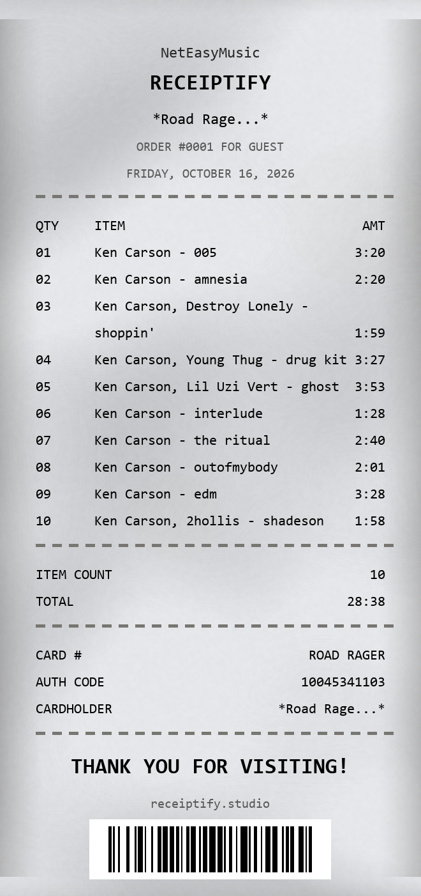

# Receiptify Studio · 复古小票歌单生成器 / Retro Receipt Generator

把网易云 / QQ音乐 / Spotify / Apple Music 歌单、iTunes 搜索、手动输入的歌单，渲染成一张**像用手机拍的复古热敏打印小票**的长图 PNG。
Turn playlists from NetEase Music / QQ Music / Spotify / Apple Music, iTunes search, or manual input into a **retro thermal-print receipt** long-image (PNG) that looks like it was photographed.

纸面带有做旧复古质感（柔和纸纹 + 平直边缘 + 条形码 + 等宽打印体），一键导出长图。
The paper carries a worn, vintage look (soft paper texture + clean straight edges + barcode + monospace type) — all in one click.



[简体中文](#简体中文) · [English](#english)

---

## 简体中文

### 功能特性

- **多种导入方式**：粘贴网易云 / QQ音乐 / Spotify / Apple Music 歌单（或网易云单曲）链接、搜索 iTunes、手动输入文本
- **中转蓄水池架构**：网络抓取的数据只以纯文本写入文本框，你可以在渲染前任意增删改；即使断网也能手动打字继续使用
- **做旧纸面质感**：程序化叠加柔和纸纹与轻微做旧阴影，每次渲染随机分布；平直边缘、条形码、等宽字体、超长歌名自动换行（时长跟随末行）、固定宽度版式
- **完整可变字段**：标题 / 订单 / 日期 / 歌曲表 / 统计 / CARD# / AUTH CODE / CARDHOLDER / 平台名——全部随导入数据生成，也可手动改
- **纯本地运行**：不上传任何数据；一键打包为单个 exe

### 快速开始

#### 1. 环境准备

需要 Python 3.10+（建议使用 venv，避免污染全局环境）：

```bat
:: Windows
python -m venv venv
venv\Scripts\activate
pip install -r requirements.txt
```

> 也可以直接双击 `install_env.bat`（若用 Anaconda，先修改其中路径）。

#### 2. 运行

```bat
venv\Scripts\python main.py
```

或双击 `启动Receiptify.bat`。

#### 3. 使用

1. 在文本框粘贴网易云链接（如 `https://music.163.com/#/playlist?id=...`），或点「搜索 iTunes」，或直接手动输入
2. 文本框里的内容就是最终渲染的源文本，可随意修改（`#` 大标题 / `##` 副标题 / `@` 底部平台名 / `;;` 注释等）
3. 点「生成小票」，选择保存路径，得到 PNG 长图

### 打包成 exe

**Windows PowerShell**（注意：PowerShell 不支持 bash 的花括号写法，DLL 需逐个传入）：

```powershell
$dlls = "tk86t","tcl86t","libcrypto-3-x64","libssl-3-x64","liblzma","libbz2","libexpat","ffi","ffi-7","ffi-8"
$args = @("--noconfirm","--clean","--onefile","--windowed","--name","ReceiptifyStudio",
          "--icon","ReceiptifyStudio.ico","--add-data","assets;assets")
foreach ($d in $dlls) { $args += "--add-binary"; $args += "D:\Software\anaconda3\Library\bin\$d.dll;." }
$args += "main.py"
& .\venv\Scripts\python.exe -m PyInstaller $args
```

产物在 `dist\ReceiptifyStudio.exe`。

### 技术架构

- **UI**：`customtkinter`（main.py）
- **网络解析**：`requests` + `re`（net.py，抓取无鉴权公开 API）
- **渲染引擎**：`Pillow`（receipt_render.py，纯函数、与 UI 完全解耦）
- **条形码**：`python-barcode`
- **做旧纸面纹理**：extract_texture.py（皱纸照片 → 柔和纸面纹理，供渲染叠加）

核心设计原则：

1. **中转蓄水池模式**：网络数据 → 纯文本 → 文本框 → 渲染层只读文本框。API 挂了，软件照常用。
2. **纯函数渲染引擎**：渲染函数里没有任何 Tkinter 代码，可独立测试（`_test_photo.py`）。
3. **资源路径动态化**：所有外部资源读取兼容 PyInstaller 的 `sys._MEIPASS` 临时解压目录。
4. **温和容错**：字体/纹理缺失自动降级（系统默认字体 / 程序化纸面），绝不闪退。

### 文件结构

```
songrecipe/
├── main.py               # 主程序（UI + 文本框 + 子线程渲染 + 保存弹窗）
├── net.py                # 网络层（网易云单曲/歌单、iTunes）
├── receipt_render.py     # 纯函数渲染引擎
├── extract_texture.py    # 做旧纸面纹理生成脚本（assets/paper_texture*.png）
├── make_icon.py          # 生成 ReceiptifyStudio.ico（迷你小票图标）
├── requirements.txt      # 依赖
├── assets/               # 纸面纹理资产
├── docs/screenshot.png   # 效果示例（由本软件生成）
└── 启动Receiptify.bat / install_env.bat
```

### License

MIT © 2026 OhRUA

---

## English

### Features

- **Multiple input methods**: paste a playlist link from NetEase Music / QQ Music / Spotify / Apple Music (or a NetEase song link), search iTunes, or type text manually
- **Reservoir-textbox architecture**: fetched data enters the UI as plain text only, so you can edit everything before rendering — and the app keeps working offline
- **Worn paper texture**: programmatic soft paper grain and subtle aged shading, randomly distributed per render; clean straight edges, barcode, monospace fonts, long titles auto-wrap (duration aligns with the last line), fixed-width layout
- **Fully editable fields**: title / order / date / song table / totals / CARD# / AUTH CODE / CARDHOLDER / platform — all generated from your imported data, all manually editable
- **100% local**: no data is uploaded; package into a single exe with one command

### Quick Start

1. `python -m venv venv` and `venv\Scripts\activate`, then `pip install -r requirements.txt`
2. Run: `venv\Scripts\python main.py`
3. Paste a NetEase link, search iTunes, or type your playlist — then click **Generate Receipt PNG** and pick a save location

### Package as exe (Windows PowerShell)

```powershell
$dlls = "tk86t","tcl86t","libcrypto-3-x64","libssl-3-x64","liblzma","libbz2","libexpat","ffi","ffi-7","ffi-8"
$args = @("--noconfirm","--clean","--onefile","--windowed","--name","ReceiptifyStudio",
          "--icon","ReceiptifyStudio.ico","--add-data","assets;assets")
foreach ($d in $dlls) { $args += "--add-binary"; $args += "D:\Software\anaconda3\Library\bin\$d.dll;." }
$args += "main.py"
& .\venv\Scripts\python.exe -m PyInstaller $args
```

Output: `dist\ReceiptifyStudio.exe`

### Architecture

- **UI**: `customtkinter` (main.py)
- **Networking**: `requests` + `re` (net.py, public no-auth APIs)
- **Render engine**: `Pillow` (receipt_render.py — pure functions, fully decoupled from the UI)
- **Barcode**: `python-barcode`
- **Texture extraction**: extract_texture.py (crumpled-paper photo → soft paper grain texture)

### License

MIT © 2026 OhRUA
